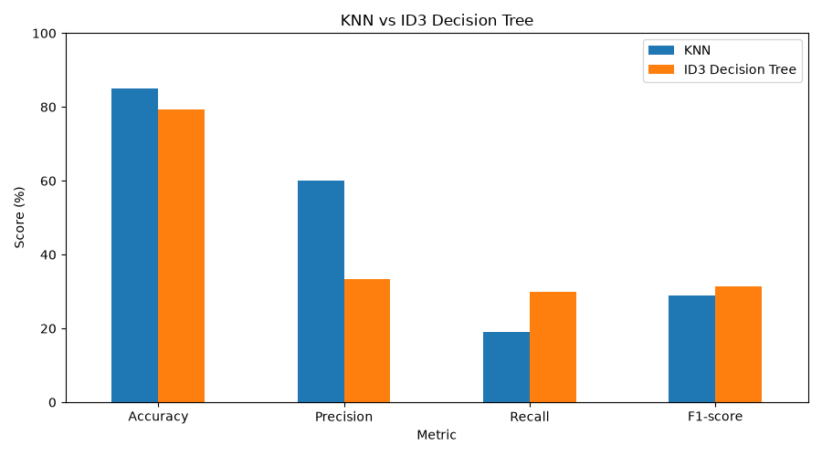
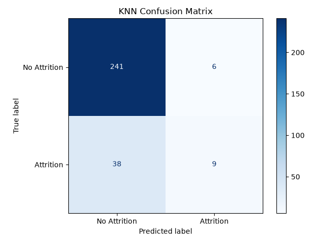
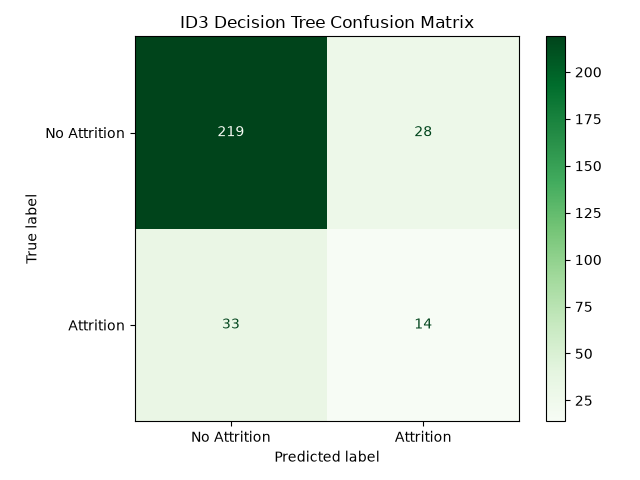
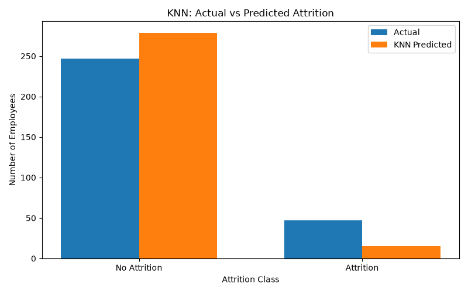
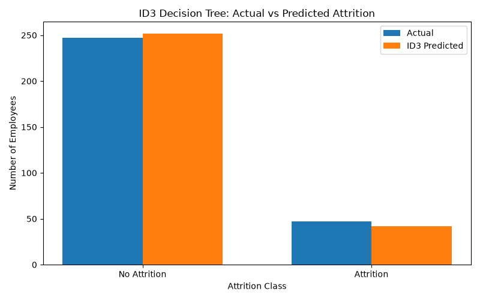
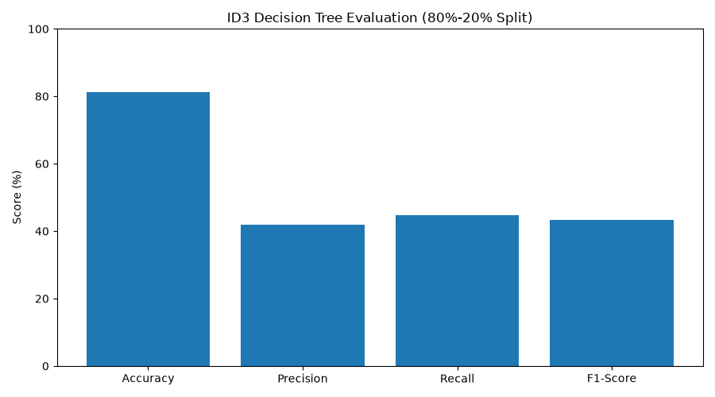

 <div align="center">

# 🔮 HR ANALYTICS
## Employee Resignation Prediction Engine

### *Will an Employee Stay or Leave?*


<p>


</p>

**Turning Employee Data into Attrition Intelligence**

[📑 Project Report](EMPLOYEE%20RESIGNATION%20RATE%20PREDICTION.pdf) • [📊 Dataset](https://www.kaggle.com/datasets/pavansubhasht/ibm-hr-analytics-attrition-dataset) • [🧠 Models](#-model-architecture) • [📈 Results](#-results--why-accuracy-lies)

</div>

---

## 🌟 Why This Project Hits Different

This project explores employee attrition prediction using two classification algorithms, combining a library-based KNN implementation with a manually developed ID3 decision tree.

> 🧠 **ID3 from Scratch:** Implemented Entropy, Information Gain and recursive tree construction without using Scikit-learn's Decision Tree classifier.

> ⚖️ **Accuracy Isn't Everything:** Demonstrated how class imbalance can make an apparently accurate model misleading.

> 🔒 **No Data Leakage:** Used training data statistics exclusively for Min-Max scaling.

**The Mathematics Behind the Models**

```python
# Entropy
Entropy(S) = - Σ p(i) * log2(p(i))

# Information Gain
Gain(S,A) = Entropy(S) - Σ (|S_v|/|S|) * Entropy(S_v)

# Min-Max Scaling
X_scaled = (X - X_min) / (X_max - X_min)
```

<details>
<summary><b>⚡ Technical Highlights</b></summary>

- 1470 employee records and 35 original columns.
- 51 encoded features after preprocessing.
- Stratified 80:20 training/testing split.
- 1176 training records and 294 testing records.
- KNN with Euclidean distance and k=5.
- Manual ID3 with 416 nodes and depth 7.
- Identical train/test indices for both models.
- Six evaluation visualizations and comparison outputs.

</details>

---

## 🏗️ Architecture – KDD Process

**Knowledge Discovery in Databases (KDD)**

```text
                 ┌──────────────────────────┐
                 │       IBM HR DATA        │
                 │                          │
                 │   1470 Records           │
                 │   35 Original Columns    │
                 │   0 Missing Values       │
                 │   0 Duplicate Records    │
                 └────────────┬─────────────┘
                              │
                 ┌────────────▼─────────────┐
                 │      PREPROCESSING       │
                 │      preprocessing.py    │
                 │                          │
                 │  • Remove 4 unnecessary  │
                 │    columns               │
                 │  • Binary target mapping │
                 │  • One-Hot Encoding      │
                 │  • Stratified 80:20 Split│
                 │  • Min-Max Scaling       │
                 │  • Save processed data   │
                 └────────────┬─────────────┘
                              │
              ┌───────────────┼────────────────┐
              │               │                │
      ┌───────▼──────┐ ┌──────▼────────┐ ┌─────▼──────────┐
      │     KNN      │ │      ID3      │ │  EVALUATION    │
      │              │ │               │ │                │
      │    k = 5     │ │ Manual Build  │ │ Accuracy       │
      │  Euclidean   │ │ Entropy       │ │ Precision      │
      │  Distance    │ │ Information   │ │ Recall         │
      │  Majority    │ │ Gain          │ │ F1-Score       │
      │  Voting      │ │ 416 Nodes     │ │ Confusion      │
      │              │ │ Depth 7       │ │ Matrix         │
      └───────┬──────┘ └──────┬────────┘ └─────┬──────────┘
              │               │                │
              └───────────────┼────────────────┘
                              │
                 ┌────────────▼─────────────┐
                 │     MODEL COMPARISON     │
                 │                          │
                 │  KNN vs ID3              │
                 │  Metrics + Visualizations│
                 │  Final Results           │
                 └──────────────────────────┘
```

---

## 📂 Complete Repository Structure

```text
DMDW_OEP/
│
├── Datasets/
│   └── WA_Fn-UseC_-HR-Employee-Attrition.csv
│       └── 223 KB | IBM HR Analytics Dataset
│
├── Terminal Output/
│   ├── Screenshot 2026-10-27 225655.png
│   ├── Screenshot 2026-10-27 230634.png
│   ├── Screenshot 2026-10-27 230641.png
│   ├── Screenshot 2026-10-27 231314.png
│   ├── Screenshot 2026-10-27 231331.png
│   ├── Screenshot 2026-10-27 233244.png
│   ├── Screenshot 2026-10-27 233253.png
│   ├── Screenshot 2026-10-27 233305.png
│   ├── Screenshot 2026-10-27 233314.png
│   └── Screenshot 2026-10-27 233319.png
│
├── preprocessing.py
├── knn.py
├── decision_tree_id3.py
├── decision_tree_id3_extra.py
├── knn_decision_tree.py
│
├── id3_model.txt
├── knn_settings.txt
├── minimum.pkl
├── maximum.pkl
│
├── knn_training_features.csv
├── knn_training_labels.csv
│
├── X_train.csv
├── X_test.csv
├── y_train.csv
├── y_test.csv
│
├── model_comparison.csv
│
├── knn_confusion_matrix.png
├── id3_confusion_matrix.png
├── knn_actual_vs_predicted.png
├── id3_actual_vs_predicted.png
├── model_comparison.png
├── evaluation_chart.png
│
├── EMPLOYEE RESIGNATION RATE PREDICTION.pdf
│
└── README.md
```

---

## ⚙️ Tech Stack – The Engineering Behind It

| Layer | Technology | Why We Chose It |
|---|---|---|
| Programming | Python 3.11 | Core implementation |
| Data Processing | Pandas | Cleaning and transformation |
| Numerical Operations | NumPy | Mathematical operations |
| Encoding | `pd.get_dummies()` | One-Hot Encoding |
| Data Splitting | `train_test_split()` | Stratified 80:20 split |
| Feature Scaling | Min-Max Scaling | Normalize numerical features |
| Classification | KNN | Distance-based prediction |
| Decision Tree | Manual ID3 | Entropy and Information Gain |
| Evaluation | Scikit-learn | Classification metrics |
| Visualization | Matplotlib | Graphs and confusion matrices |
| Model Storage | Pickle / CSV / TXT | Save parameters and results |

---

## 🧠 Model Architecture

### 01. K-Nearest Neighbors (KNN)

**Instance-Based Learning | K = 5**

KNN is a supervised classification algorithm that predicts the class of a new record based on the majority class of its nearest neighbors.

**Implementation:**

```python
from sklearn.neighbors import KNeighborsClassifier

knn = KNeighborsClassifier(n_neighbors=5)

knn.fit(X_train, y_train)

pred = knn.predict(X_test)
```

**How it works:**

1. Stores the 1176 training records.
2. Calculates Euclidean distance between test and training records.
3. Identifies the five nearest neighbors.
4. Uses majority voting to predict Attrition (0 or 1).

**Key Characteristics:**

- Euclidean distance measurement.
- Lazy learning algorithm.
- Requires feature scaling.
- Uses majority voting.
- No explicit model-building phase.

**Saved Outputs:** `knn_training_features.csv`, `knn_training_labels.csv`, `knn_settings.txt`.

### 02. ID3 Decision Tree – Built From Scratch

**Manual Implementation | 416 Nodes | Depth 7**

Instead of using a predefined Decision Tree classifier, we implemented the ID3 algorithm manually using Entropy and Information Gain.

**Core Functions:**

```python
def entropy(labels):
    # Calculate entropy

def information_gain(data, feature, target):
    # Calculate information gain

def build_tree(data, features, target, default):
    # Recursively build the tree

def predict_tree(tree, row, default):
    # Predict using the decision tree
```

**How it works:**

1. Calculates the entropy of the dataset.
2. Calculates Information Gain for available features.
3. Selects the feature with maximum Information Gain.
4. Splits the dataset into branches.
5. Recursively builds the decision tree.
6. Predicts using the constructed tree.

**Special Implementation Details:**

| Feature | Implementation |
|---|---|
| Entropy | Manual mathematical calculation |
| Splitting | Maximum Information Gain |
| Tree Construction | Recursive |
| Numeric Attributes | `pd.cut(bins=4)` |
| Unseen Values | Default majority class |
| Root Feature | JobRole |
| Total Nodes | 416 |
| Maximum Depth | 7 |

**Saved Output:** `id3_model.txt` – readable representation of the complete decision tree.

### 🔐 Fair Model Comparison

Both models use exactly the same training and testing indices.

- Same stratified 80:20 split.
- Same 1176 training records.
- Same 294 testing records.
- Training-only scaling statistics.
- No test-data leakage into scaling parameters.

This ensures a consistent comparison between KNN and ID3.

---

## 📊 Dataset – Understanding Employee Attrition

**Source:** IBM HR Analytics Employee Attrition Dataset.

[Explore Dataset on Kaggle](https://www.kaggle.com/datasets/pavansubhasht/ibm-hr-analytics-attrition-dataset)

### Dataset Overview

| Property | Value |
|---|---:|
| Total Records | 1470 |
| Original Attributes | 35 |
| Missing Values | 0 |
| Duplicate Records | 0 |
| Encoded Features | 51 |

### Attrition Distribution

| Employee Status | Records | Percentage |
|---|---:|---:|
| Stayed (No) | 1233 | 83.9% |
| Left (Yes) | 237 | 16.1% |
| **Total** | **1470** | **100%** |

The dataset is highly imbalanced, with significantly fewer employees leaving than staying.

### Preprocessing Pipeline

| Step | Operation | Result |
|---|---|---|
| 1 | Remove EmployeeNumber, EmployeeCount, Over18, StandardHours | 31 columns remain |
| 2 | Map Attrition No → 0, Yes → 1 | Binary target |
| 3 | One-Hot Encoding | 30 columns → 51 features |
| 4 | Stratified splitting | 1176 train / 294 test |
| 5 | Min-Max Scaling | Training statistics only |
| 6 | Handle constant columns | `fillna(0)` |

**Final Feature Composition:**

- 23 numerical features.
- 28 binary encoded features.
- 51 total input features.

---

## 📈 Results – Why Accuracy Lies

### Test Set Performance

| Metric | KNN | ID3 | Better |
|---|---:|---:|---|
| Accuracy | **85.03%** | 79.25% | KNN |
| Precision | **60.00%** | 33.33% | KNN |
| Recall | 19.15% | **29.79%** | ID3 |
| F1-Score | 29.03% | **31.46%** | ID3 |
| Specificity | **97.57%** | 88.66% | KNN |

### Confusion Matrix Comparison

| Prediction | KNN | ID3 |
|---|---:|---:|
| True Negative (TN) | 241 | 219 |
| False Positive (FP) | 6 | 28 |
| False Negative (FN) | 38 | 33 |
| True Positive (TP) | 9 | 14 |

**What does this mean?**

- KNN correctly identifies 9 out of 47 employees who left.
- ID3 correctly identifies 14 out of 47 employees who left.
- KNN makes fewer false positive predictions.
- ID3 catches more actual resignations.

### 🚨 VIVA KILLER LINE – WHY ACCURACY IS MISLEADING

**A model that predicts every employee will stay achieves 84.01% accuracy without learning anything about attrition!**

```text
Total Test Records       = 294
Employees Who Stayed     = 247
Employees Who Left       = 47

Baseline Accuracy:

247 / 294 × 100 = 84.01%

KNN Accuracy = 85.03%
ID3 Accuracy = 79.25%
```

**The Reality:**

KNN achieves 85.03% accuracy, only about one percentage point above the baseline.

This is why accuracy alone cannot determine whether a classification model is good, especially when the dataset is imbalanced.

For HR analytics, identifying employees who may resign is important. Therefore, Recall and F1-score provide additional insight into model performance.

<details>
<summary><b>🔍 Final Model Interpretation</b></summary>

**KNN:**

- Higher accuracy and precision.
- Higher specificity.
- Lower recall.
- Misses 38 actual resignations.

**ID3:**

- Lower accuracy and precision.
- Better recall and F1-score.
- Identifies more employees who actually left.
- Misses 33 actual resignations.

**Conclusion:** ID3 performs better at identifying employees who left, while KNN performs better at predicting employees who stayed.

Neither model is sufficiently strong at detecting attrition, and further improvement is required.

</details>

---

## 📸 Visual Results & Model Evaluation

### 01. Overall Model Comparison



### 02. Confusion Matrices

| KNN – k=5 | ID3 – Manual |
|:---:|:---:|
|  |  |

### 03. Actual vs Predicted

| KNN Predictions | ID3 Predictions |
|:---:|:---:|
|  |  |

### 04. Evaluation Chart



---

## 🖥️ Terminal Output – Execution Evidence

<details>
<summary><b>📂 Click to explore all 10 terminal screenshots</b></summary>

All screenshots are available in the `Terminal Output/` directory.

| No. | Screenshot | Evidence |
|---:|---|---|
| 01 | `225655.png` | Preprocessing, shape and null check |
| 02 | `230634.png` | Attrition distribution: 1233 vs 237 |
| 03 | `230641.png` | After dropping unnecessary columns |
| 04 | `231314.png` | Training and testing split |
| 05 | `231331.png` | KNN evaluation results |
| 06 | `233244.png` | ID3 Entropy and Information Gain logs |
| 07 | `233253.png` | ID3 evaluation results |
| 08 | `233305.png` | Confusion matrices |
| 09 | `233314.png` | Model comparison table |
| 10 | `233319.png` | Final model_comparison.csv |

**Execution Date:** 27 October 2026

</details>

---

## 🚀 Quick Start – Run Locally

### 1. Clone the Repository

```bash
git clone https://github.com/honeygajjar2006-svg/HR-Analytics---Predicting-whether-an-employee-will-resign.git
```

### 2. Install Dependencies

```bash
pip install pandas numpy scikit-learn matplotlib
```

### 3. Execute the Project

Run preprocessing first:

```bash
python preprocessing.py
```

Then execute both classification models:

```bash
python knn_decision_tree.py
```

**Expected Outputs:**

- Preprocessed training and testing datasets.
- Saved Min-Max scaling parameters.
- KNN classification results.
- ID3 decision tree and tree representation.
- Classification metrics.
- Confusion matrices and comparison graphs.
- `model_comparison.csv`.

Run commands from the project root. Keep the original dataset inside the Datasets folder and ensure the script's dataset path matches its location.

---

## 🔮 Limitations & Future Scope

### Current Limitations

| Limitation | Explanation |
|---|---|
| Low Recall | Both models miss several actual resignations. |
| Class Imbalance | Only 16.1% of records represent attrition. |
| Single Split | Evaluation uses one 80:20 split. |
| Small Test Positives | Only 47 actual leavers in the test set. |
| Fixed K | KNN uses k=5 without extensive tuning. |
| No Pruning | ID3 may overfit with a 416-node tree. |
| Equal-Width Binning | Numeric information is lost during discretization. |
| Dataset Scope | IBM sample data is not representative of every organization. |

### Future Enhancements

| Enhancement | Expected Benefit |
|---|---|
| SMOTE | Handle class imbalance |
| GridSearchCV | Find better hyperparameters |
| Random Forest | Explore ensemble classification |
| XGBoost | Test advanced boosting |
| SHAP | Explain model predictions |
| Feature Selection | Identify influential attributes |
| Cross-Validation | Improve evaluation reliability |
| Pruning | Reduce decision tree complexity |

---

## 👩‍💻 Meet the Team

<div align="center">

### TEAM DIV-II

**Computer Engineering | SCET | Semester V**

*One Team. Two OEPs. Multiple Technologies.*

</div>

| Team Member | Enrollment No. | Role | Contribution |
|---|---|---|---|
| Mariyah Tajani | ET24BTCO127 | Data Lead | Dataset, preprocessing and insights |
| Tasmi Hirpara | ET24BTCO130 | Visualization Lead | Graphs and confusion matrices |
| Arshi Trivedi | ET24BTCO142 | Algorithm Lead | Manual ID3 implementation |
| **Honey Gajjar** | **ET24BTCO150** | **Repository Owner** | **KNN, GitHub and integration** |
| Khushi Patel | ET24BTCO165 | Evaluation Lead | Metrics, comparison and report |

### Under the Guidance of

- Prof. (Dr.) Dipali Kasat
- Prof. (Dr.) Rachna Oza
- Prof. Snehal Gandhi

<div align="center">

**Sarvajanik College of Engineering and Technology (SCET)**

Department of Computer Engineering

**Subject:** Data Mining and Data Warehousing (BTCO14505)  
**Division:** II | **Semester:** V | **Academic Year:** 2026–27

</div>

---

## 📚 References & Learning Resources

1. **Dataset:** [IBM HR Analytics Employee Attrition – Kaggle](https://www.kaggle.com/datasets/pavansubhasht/ibm-hr-analytics-attrition-dataset)
2. **Scikit-learn:** Pedregosa et al., *Scikit-learn: Machine Learning in Python*, Journal of Machine Learning Research, 2011.
3. **KNN:** Cover, T. and Hart, P., *Nearest Neighbor Pattern Classification*, IEEE Transactions on Information Theory, 1967.
4. **ID3:** Quinlan, J. R., *Induction of Decision Trees*, Machine Learning, 1986.
5. **Data Mining:** Han, J., Kamber, M. and Pei, J., *Data Mining: Concepts and Techniques*, 3rd Edition.

---

<div align="center">

## ⭐ Like Our Work? Star This Repository!

**Built with 💜 by Team Div-II | SCET SEM 5 DMDW OEP 2026**

*Same Team as ProjectHub WT OEP – Different Subject, Same Excellence.*


**Thank You for Exploring Our Project!**

</div>